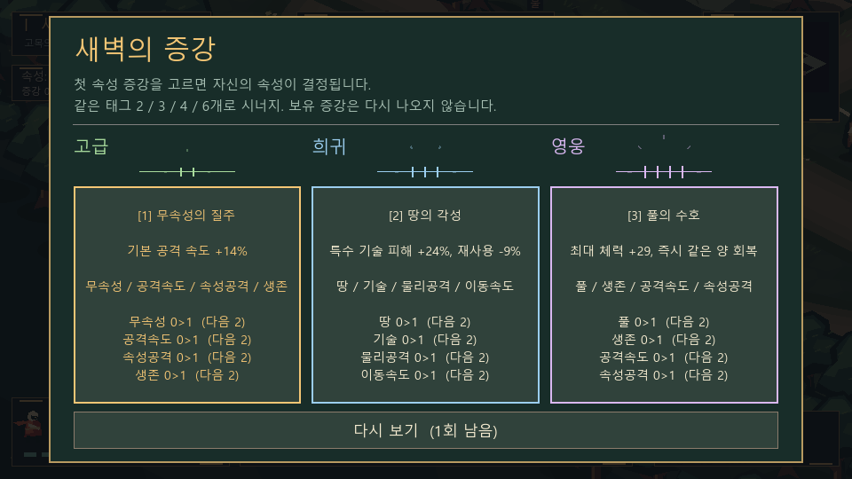
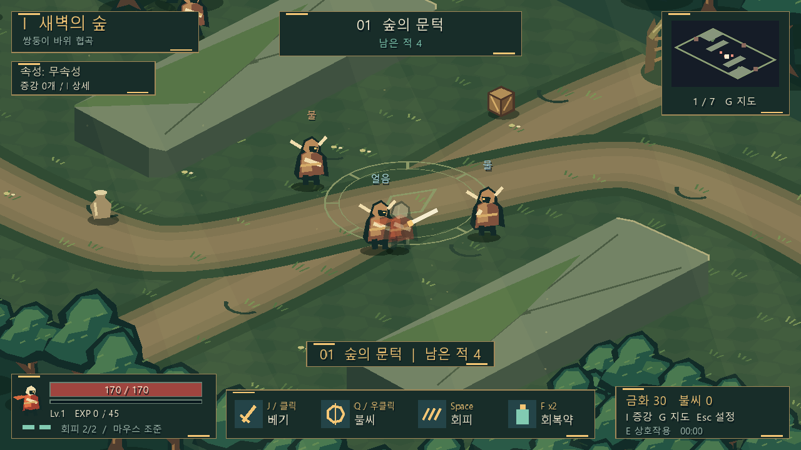
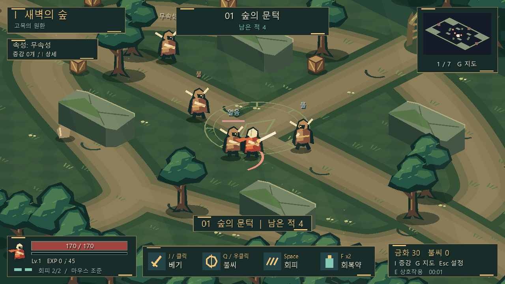
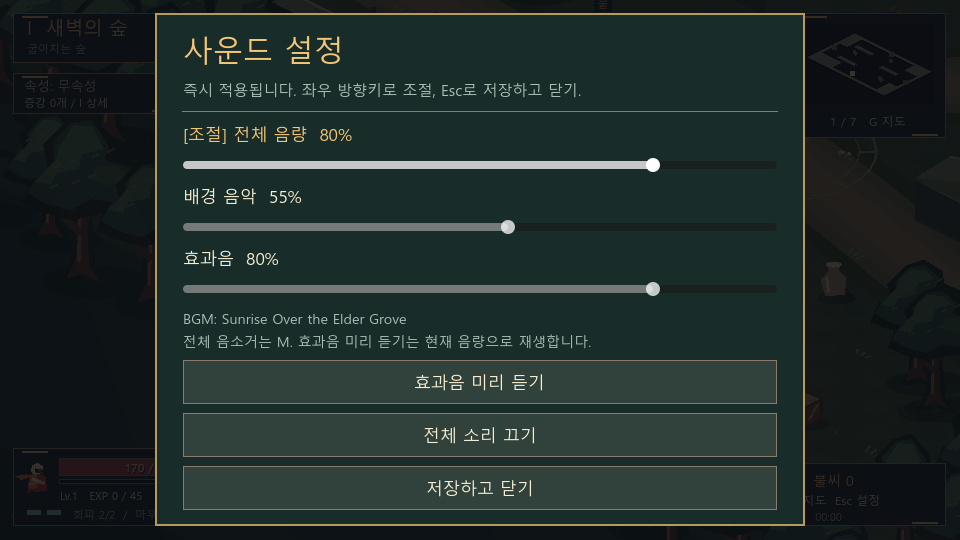

# 불씨의 성소 (Ember Sanctuary)

Godot 4.5.1로 만든 Windows x64용 **쿼터뷰 액션 로그라이트 데모**입니다.
첫 스테이지인 **새벽의 숲**, 일곱 방, 보스, 영구 강화가 들어 있습니다.
Hades의 공간 표현과 타격 대비를 참고하지만, 캐릭터·환경·UI·효과음은 독자적으로 제작했습니다.
원작의 이미지나 음원은 사용하지 않습니다. 배경 음악은 사용자가 제공하고 재배포를 허락한 파일입니다.

## 이번 개편

- 숲 지형 **다섯 구조**를 한 주기 안에서 중복 없이 순환시킵니다. 주기 경계에서도 같은 구조가 연속하지 않습니다.
- **유물 가방·칸 이동·중첩·인접 보너스를 제거**했습니다. 보상 화면은 증강 세 개와 다시 보기만 표시합니다.
- **132개 증강 정의**: 10속성 × 12개, 속성 선택 전용 공용 증강 12개. 같은 증강은 한 탐험에 한 번만 획득합니다.
- 처음 속성 증강을 선택하면 **자신의 고유 속성과 공격 속성이 결정**됩니다. 이후 해당 속성 증강만 나옵니다. 공용 증강은 속성 결정 전만 등장하며 속성을 결정하지 않습니다.
- 여러 태그를 가진 증강을 모아 **2/3/4/6개 시너지**를 발동합니다. 등급과 무관하게 서로 다른 증강 하나가 각 태그에 1개씩 기여합니다.
- 6등급 확률·성능·문양·등장 효과·효과음을 구분했습니다.
- 제공된 **Sunrise Over the Elder Grove**를 게임 시작부터 반복 재생합니다.
- **Esc > 사운드 설정**에서 전체·음악·효과음 음량, 음소거, 효과음 미리 듣기를 제공합니다.
- 플레이어와 적 양쪽에 고유 속성, 반응, 지속 피해, 행동 제어, 방어력, 보호막을 적용합니다.



## 실행 및 배포

- 개발 실행: `start_game.cmd` 또는 `build\EmberSanctuary.exe`. 같은 폴더의 `EmberSanctuary.pck`가 필요합니다.
- **배포용 단일 파일**: `build\release\EmberSanctuary.exe`. 게임과 BGM이 포함되어 별도 PCK나 Godot 설치가 필요 없습니다.
- **배포 ZIP**: `build\EmberSanctuary-Windows-x64.zip`. EXE, README.txt, Godot 라이선스·저작권 고지의 네 파일입니다.
- Windows 10/11 x64, OpenGL 3.3 호환 그래픽이 필요합니다. EXE는 코드 서명되지 않아 SmartScreen 경고가 나올 수 있습니다.
- 기본 1280×720, 최소 960×540. 화면 비율을 유지합니다. 키보드·마우스용이며 모바일·게임패드는 지원하지 않습니다.

## 조작과 진행

| 기능 | 입력 |
|---|---|
| 화면 기준 이동 | WASD / 방향키 |
| 조준 | 마우스, 적 몸체를 가리켜도 발 위치를 대상으로 선택 |
| 기본 베기 | 좌클릭 유지 / J |
| 특수 기술 | 우클릭 / Q / K |
| 회피 | Space, 2회 충전 |
| 회복약 / 상호작용 | F / E |
| 일시정지·사운드 설정 | Esc |
| 증강·시너지 목록 / 지도 | I / G |
| 조작 수첩 | Tab |
| 마우스·이동 방향 조준 전환 | T |
| 화면 흔들림·섬광 전환 / 전체 음소거 | V / M |
| 증강 선택 | 1 / 2 / 3 또는 클릭 |
| 메뉴 | Tab / Shift+Tab, Enter / Space |
| 슬라이더 | Tab으로 선택, 좌우 방향키로 조절 |
| 사망·승리 후 재도전 | R |

1. 야영지에서 성소에 들어갑니다. 먼 적은 가까이 가면 추격을 시작합니다.
2. 공격 예고를 보고 회피하면서 적을 모두 처치하고 증강 하나를 고릅니다.
3. 열린 서쪽 출구(E)는 일반 전투, 동쪽 출구(E)는 강화 전투입니다. 북쪽 경로판(E)에서 메뉴로 고를 수도 있습니다.
4. 쿼터뷰에서 서쪽은 화면 왼쪽 위, 동쪽은 오른쪽 아래, 북쪽은 오른쪽 위입니다. 미니맵의 금빛 출구를 확인하세요.
5. 네 번째 방은 휴식·보물·금화 상인 중 선택합니다. 일곱 번째 방은 수호자입니다.
6. 사망·귀환·정상 종료 시 불씨를 정산합니다. 야영지 강화는 5단계이며 단계당 시작 체력 +12, 공격력 +2입니다.

기본 공격의 실제 적중은 입력 0.045초 뒤, 특수 기술은 0.07초 뒤입니다. 선딜 중 회피하면 취소됩니다.
3연격 마지막 타격은 1.6배, 기술 기본 계수는 2.4배, 회피 공격은 사거리 +22·피해 +25%입니다.
일반 피격 무적은 0.75초이며 지속 피해에는 적용하지 않습니다. 회피 충전은 기본 1초입니다.
넉백은 대상별 3초 재적용 제한이 있으며 벽 충돌은 추가 피해 10입니다.
상자·항아리를 파괴하면 금화 3, 적 처치로 금화·경험치·불씨를 얻습니다.
레벨업은 최대 체력 +5, 공격력 +2, 체력 15 회복입니다. 바닥 불씨는 체력을 1 회복합니다.
강화 방은 적 체력·불씨 보상이 증가하고 증강 선택 시 체력을 12 회복합니다.
금화와 경험치는 이번 탐험에만 유지됩니다.

## 다섯 숲 구조

| 구조 | 전투 동선 |
|---|---|
| 교차하는 숲길 | 중앙 공터와 교차로, 두 방향의 바위 엄폐 |
| 쌍둥이 바위 협곡 | 긴 세로 바위 사이의 중앙 통로와 바깥 우회로 |
| 고목의 원환 | 네 바위와 고목을 둘러가는 고리, 중앙 관통로 |
| 갈라진 정원 | 상하의 긴 바위가 공터를 나누는 가로 전투축 |
| 굽이치는 숲 | 세 줄의 엇갈린 바위와 구불구불한 접근로 |

각 구조는 길, 장애물, 가장자리 숲 덩어리와 통과 가능한 공간이 다릅니다.
충돌·투사체 차단·경로 탐색·미니맵에 같은 장애물 데이터를 사용합니다.
입구·제단·세 출구와 적 생성 지점의 연결성을 자동 검사합니다. 전투 중 적을 추가 생성하지는 않습니다.
바깥 좌표 범위는 1376×832로 같지만 내부와 가장자리의 통행 구조는 서로 다릅니다.
무한 던전 생성기가 아니라, 첫 스테이지에 수제 구조 다섯 개를 순환시키는 방식입니다.




## 증강, 등급, 다시 보기

각 속성에는 박동·칼날·파동·걸음·수호·각성·질주·공명·잔향·흐름·숨결·의식의 12개 증강이 있습니다.
주효과는 순서대로 공격속도·물리공격·속성공격·이동속도·생존·기술이 두 번 반복됩니다.
같은 효과 계열이라도 ID가 다른 증강은 별개로 획득할 수 있습니다. 이미 획득한 ID는 다시 나오지 않습니다.
속성 증강은 속성 태그와 능력 태그 3개를 가집니다. 공용 증강은 능력 태그 2개입니다.
보상에 실제 증가 수치, 태그, 현재 개수에서 선택 후 개수, 다음 임계값을 표시합니다.

| 등급 | 선택지 하나당 확률 | 주효과 배율 | 식별 |
|---|---:|---:|---|
| 일반 | 45% | 1.0 | 회백색, 1획 |
| 고급 | 27% | 1.2 | 녹색, 2획 |
| 희귀 | 16% | 1.5 | 청색, 3획 |
| 영웅 | 8% | 1.9 | 연보라, 4획 |
| 초월 | 3% | 2.4 | 산호색, 5획 |
| 전설 | 1% | 3.0 | 금색, 6획 |

각 선택지의 등급은 독립 추첨하며 고등급을 보장하지 않습니다.
등급마다 문양의 획 수, 등장 파편의 수·속도·길이, 효과음의 길이·음정 진행·배음을 다르게 만듭니다.
창이 열리면 최고 등급 소리, 키보드로 다른 선택지에 초점을 옮기거나 획득하면 해당 등급 소리가 납니다.
V로 화면 효과를 끄면 등장 파편도 생략하고 문양·이름·테두리는 유지합니다.

일반 기준 주효과:

- 공격속도: 기본 공격 속도 +12%.
- 물리공격: 기본 베기 피해 +15%.
- 속성공격: 현재 속성의 베기·기술 피해 +15%. 무속성 빌드에도 적용합니다.
- 이동속도: 이동 속도 +8%, 회피 충전 시간 -5%.
- 생존: 최대 체력 +15 및 같은 양 회복.
- 기술: 기술 피해 +16%, 재사용 시간 -6%.

배율을 적용한 같은 능력 수치는 합산합니다. 공격속도는 초당 공격 횟수를 높이는 방식입니다.
공격 간격 하한은 0.10초, 회피 충전 하한은 0.35초, 기술 재사용 하한은 1초입니다.
체력 증가는 정수 반올림하며 다른 효과는 실제 소수 수치로 계산하고 UI에서 반올림합니다.
보상마다 무료 다시 보기 1회가 있으며 가능하면 직전의 세 ID를 제외합니다. 보유 ID는 항상 제외합니다.
Esc로 보상을 미룬 뒤 중앙 제단(E)에서 **같은 증강·같은 등급**으로 다시 엽니다.
상점은 증강 25금화(방당 1회), 체력 35 회복·회복약 1개 보충은 12금화입니다.
I 목록은 읽기 전용이며 태그별 현재 단계와 모든 시너지 설명, 획득 증강을 스크롤로 확인합니다.

## 2/3/4/6 시너지

각 열의 효과는 누적됩니다. 같은 증강의 등급이 높아도 태그 개수는 1입니다.

| 태그 | 2개 | 3개 | 4개 | 6개 |
|---|---|---|---|---|
| 각 속성 | 해당 속성 피해 +12% | 추가 +12% | 기술 뒤 속성 파동(35% 기술 피해, 범위 +55) | 기술 기본 반경 +90, 대범위 원소 폭풍 |
| 공격속도 | 속도 +10% | 추가 +10% | 3연격 끝 충격파(30% 기본 피해, 사거리 +35) | 매 베기 충격파 |
| 물리공격 | 기본 피해 +10% | 추가 +10% | 기본 사거리 +20 | 기본 검격 추가타 35% |
| 속성공격 | 속성 피해 +10% | 추가 +10% | 기술 피해 +25% | 0.24초 뒤 60% 기술 피해의 2차 폭발 |
| 이동속도 | 속도 +8% | 회피 충전 -15% | 회피 경로 초당 공격력 2배 피해 | 경로 피해 2배 |
| 생존 | 받는 피해 -8% | 회복량 +20% | 기술 사용 시 보호막 12(3초) | 보호막 24 |
| 기술 | 기술 재사용 -10% | 기술 피해 +15% | 기술 반경 +30 | 0.24초 뒤 60% 기술 피해의 2차 폭발 |

속성공격·기술의 6개 효과는 같은 2차 폭발이며 둘 다 활성화되어도 3차 폭발로 중복하지 않습니다.
기본 기술 반경은 136입니다. 시너지 파동과 폭발은 현재 속성으로 반응하며, 검격 추가타·회피 경로 피해는 반응을 재발동하지 않습니다.
한 탐험의 보상 수는 제한적입니다. 모든 태그의 6개 효과를 동시에 완성하는 장기 모드는 아닙니다.

## 원소 반응

속성: **무속성·불·얼음·물·땅·풀·바람·번개·양자·허수**.
공격 속성과 **대상의 고유 속성**으로 판정하며 반응으로 고유 속성이 바뀌지 않습니다.
적의 속성은 머리 위, 보스는 체력바 이름, 자신의 속성은 왼쪽 HUD에 표시합니다.
적 근접·투사체·지면 기술에도 공격자의 속성을 전달합니다. 플레이어도 같은 규칙으로 피해와 상태 효과를 받습니다.
양자·허수는 서로에게만 반응하지만 다른 속성의 기본 피해에도 정상적으로 피해를 받습니다.

D는 치명타·능력 보정·방어를 계산한 뒤 반응 배율을 적용하기 전 피해입니다.
방어 공식은 `피해 × 100 / (100 + 방어력)`입니다. 플레이어 20, 추격·원거리 적 10, 중장 적 30, 보스 40입니다.
초전도는 방어력 자체를 20% 낮춥니다. 반응 추가 피해에는 별도 치명타나 새 반응이 없습니다.
문서의 1m는 지면 40단위로 해석해 반응 반경 3m는 120단위입니다.

| 조합(양방향) | 효과 |
|---|---|
| 불 + 얼음 / 불 + 물 | 융해 / 증발: D × 1.5 |
| 불 + 땅 | 용암: 3초 지대, 매초 15%D 광역 |
| 불 + 풀 | 연소: 4초, 매초 15%D |
| 불 + 번개 | 과부하: 대상과 주변 40%D, 넉백 |
| 얼음 + 물 | 빙결: 2초 이동·행동 불가 |
| 얼음 + 땅 | 동토: 4초 이동 속도 -40% |
| 얼음 + 풀 | 동해: 4초 공격속도 -20%, 받는 회복 -30% |
| 얼음 + 번개 | 초전도: 추가 20%D, 5초 방어력 -20% |
| 물 + 땅 | 진창: 4초 이동 속도 -30%, 회피 금지 |
| 물 + 풀 | 개화: 2초 후 씨앗 폭발 50%D 광역 |
| 물 + 번개 | 감전: 3초 매초 15%D, 매 틱 가까운 같은 편 최대 2개체에 같은 피해 전이 |
| 땅 + 풀 | 생장: 1.5초 속박, 공격·기술은 가능 |
| 땅 + 바람 | 모래폭풍: 3초 지대, 매초 10%D, 지대 안 상대편 명중률 -15% |
| 땅 + 번개 | 접지: 추가 25%D, 공격자에게 30%D 보호막 3초 |
| 풀 + 번개 | 활성: 5초 받는 풀·번개 피해 +20%, 발동시킨 첫 타격에는 미적용 |
| 바람 + 불·얼음·물·풀·번개 | 해당 원소 확산: 첫 대상은 기본 피해, 주변 상대편에 30%D, 재확산 없음 |
| 양자 → 허수 / 허수 → 양자 | 붕괴 / 역설: D × 1.5 |

무속성·동일 속성은 반응하지 않습니다.
융해·증발·붕괴·역설은 매 타격 배율 적용, 나머지는 공격자·대상·반응별 재발동 대기시간 1초입니다.
연소·감전은 같은 공격자 기준으로 중첩 없이 최신 D와 지속 시간·다음 틱을 갱신합니다.
둔화·약화는 강도 중첩 없이 시간을 갱신하고 가장 강한 이동 감소 하나만 적용합니다.
용암·모래폭풍은 공격자·종류별 지대 하나만 유지하며 새 지대가 이전 지대를 대체합니다.
씨앗은 공격자당 최대 3개이며 초과하면 가장 오래된 씨앗이 즉시 폭발합니다.
보호막은 기존 잔여량과 새 양 중 큰 값을 유지하고 시간을 갱신합니다.
빙결·속박 종료 후 3초간 두 제어에 면역입니다. 넉백 재적용도 대상별 3초 제한입니다.
보스 등 제어 면역 대상에게는 제어 대신 2초간 이동 속도 -20%를 적용합니다.
빙결은 모든 공격·회피를, 속박은 이동·회피를 막습니다. 별도 돌진형 적은 현재 데모에 없습니다.

## 소리와 저장



게임 시작·야영지·전투·메뉴에서 BGM을 이어서 반복 재생합니다.
전체 음량은 음악과 효과음에 곱해지며 두 채널은 독립 조절합니다. 0%로 끄거나 M으로 전체 음소거할 수 있습니다.
Esc 메뉴는 전투와 반응 타이머를 멈추지만 음악은 계속 재생합니다.
사운드 설정은 닫을 때 `audio_settings.json`에 저장합니다. 현재 수치와 음소거가 다음 실행에 복원됩니다.
손상되거나 저장할 수 없는 설정은 화면과 로그에 오류를 알리고 기존 파일을 보존합니다. 저장 오류가 있어도 닫고 플레이할 수 있습니다.
임의 설정 값으로 조용히 덮어쓰지는 않습니다.

영구 불씨·강화·최고 진행도는 기존 `sanctuary_save.json` 형식을 유지합니다.
두 파일은 `%APPDATA%\Godot\app_userdata\` 아래 게임 폴더에 있으며 임시 파일에 기록한 뒤 교체합니다.
진행 중 탐험·증강·금화는 저장하지 않습니다. 정상 종료 시 불씨를 정산하고, 재실행은 야영지에서 시작합니다.
손상된 진행 저장은 덮어쓰지 않고 영구 강화 구매를 막습니다. 강제 종료·전원 차단 직전의 불씨 정산은 보장하지 않습니다.

BGM 파일: `audio\Sunrise_Over_the_Elder_Grove.mp3`.
사용자가 직접 제공했고 이번 게임의 EXE·ZIP 포함 및 재배포를 허락했습니다.
이 README는 별도의 작곡가나 공개 라이선스를 추정하지 않으며 음원을 독립적으로 재배포할 권리를 부여하지 않습니다.

## 표현과 제작 방향

지면은 `(0.86x - 0.86y, 0.43x + 0.43y)`의 2:1 투영입니다. 몸체·나무·이름표는 수직으로 세웁니다.
이동·회피는 화면 방향, 사거리·충돌·경로 탐색은 지면 좌표, 조준·미니맵은 같은 변환을 공유합니다.
원형 광역 기술은 화면에서 타원으로 보입니다. 실제 3D가 아니라 2D 도형과 면 명암으로 만든 표현입니다.
플레이어를 가리는 나무는 반투명하며, 공격 예고와 피해·상태 이름은 배경과 구분합니다.

사용자가 제공한 Sephiria·Heroes of Hammerwatch II·Hades 영상은 로컬에서만 관찰했습니다.
Sephiria의 탐험·선택 흐름, Hammerwatch의 지형 우회, Hades의 쿼터뷰·회피 연계·순간 타격 대비를 참고했습니다.
가방은 최신 요구에 따라 제거했습니다. 원작 영상 프레임·UI 이미지·캐릭터·로고·음원은 배포본에 포함하지 않습니다.
현재는 단일 직업·첫 스테이지 데모입니다. 장비 교체, 후속 스테이지, 대사·퀘스트, 온라인 기능은 없습니다.
자동 완주는 사람에 의한 난이도·장기 밸런스 검증을 대신하지 않습니다.

### 시각 결정의 근거

- ENERGY 3 / RHYTHM 2 / MOTION 3: 숲의 깊이와 순간 타격에 힘을 주고 메뉴는 차분하게 읽도록 구분합니다.
- 짙은 숲색·이끼색과 금빛 강조: 숲의 정체성을 유지하면서 현재 선택과 출구를 찾기 쉽도록 합니다.
- 등급·속성 색은 장식 팔레트가 아니라 상태 부호입니다. 반드시 이름·문양·숫자와 함께 표시합니다.
- 한국어 시스템 글꼴: 작은 전투 화면에서도 한글의 획이 뭉개지지 않도록 합니다.
- 세 선택지의 동일 폭: 같은 결정을 비교하기 위한 구성으로 가방이나 광고성 장식을 옆에 넣지 않습니다.
- 반응 파동·등장 파편·효과음: 범위·발동·등급 정보를 전달합니다. 정적 문양과 텍스트로도 식별할 수 있습니다.
- 스크롤 목록: 획득 증강과 태그 수가 늘어나도 닫기·도움말 버튼은 화면에 남깁니다.

## 소스와 재빌드

`open_editor.cmd` 또는 Godot 4.5.1에서 `project.godot`를 열어 F5로 실행합니다.

| 파일 | 역할 |
|---|---|
| `scripts\game.gd` | 전투·방 진행·보상·UI·저장·투영 |
| `scripts\augments.gd` | 카탈로그·등급 확률·태그 계산·설명 |
| `scripts\elements.gd` | 양방향 반응·상태·지대·씨앗·보호막 |
| `scripts\forest_maps.gd` | 다섯 지형·경로·가장자리 숲 |
| `scripts\forest_art.gd` | 독자적 수직 캐릭터·숲 그림 |
| `scripts\rarity_effect.gd` | 등급별 문양과 등장 연출 |
| `scripts\sound.gd` | BGM·효과음 합성·음량·설정 저장 |
| `tests\integration.gd` | 실제 UI 입력·원소·증강·맵·음량·전투 검사 |

```powershell
# 프로젝트 폴더에서, 동일 버전의 공식 Windows export template이 필요합니다.
& '.\runtime\Godot_v4.5.1-stable_win64.exe' --headless --editor --path '.' --quit | Out-Host
& '.\runtime\Godot_v4.5.1-stable_win64.exe' --headless --path '.' --export-pack 'Windows Desktop' '.\build\EmberSanctuary.pck' | Out-Host
& '.\runtime\Godot_v4.5.1-stable_win64.exe' --headless --path '.' --export-release 'Windows Release' '.\build\release\EmberSanctuary.exe' | Out-Host

# 모든 EXE 프로세스를 닫은 다음 패키징합니다.
Compress-Archive -Path '.\build\release\EmberSanctuary.exe','.\build\release\README.txt','.\build\release\GODOT_LICENSE.txt','.\build\release\GODOT_COPYRIGHT.txt' -DestinationPath '.\build\EmberSanctuary-Windows-x64.zip' -CompressionLevel Optimal -Force

# 관련 검사를 한 번에 실행합니다. 종료 코드뿐 아니라 아래 성공 표식과 오류 유무를 확인하세요.
foreach ($suite in 'self','overhaul','ui','quarter','combat') {
  & '.\runtime\Godot_v4.5.1-stable_win64.exe' --headless --path '.' --quit-after 1800 -- "--$suite-test" | Out-Host
}
```

## 검증 범위

- `SELF_TEST_PASS`: 기본 전투·회피·회복·증강·분기·보스 패턴·정산·영구 강화 등 15개 그룹.
- `OVERHAUL_TEST_PASS`: 일반 원소 21조합의 양방향 반응, 무속성·특수 원소 독립성, 지속 피해·면역·지대·씨앗·방어·보호막.
- 같은 검사에서 10개 속성의 중복 없는 잠금 풀, 등급 구간 경계와 100,000회 표본, 2/3/4/6 단계, 모든 능력 태그의 실제 6개 효과를 확인합니다.
- 5종 지형의 2주기 순환·비연속 반복, 입구에서 제단·모든 출구·생성된 적까지 경로 연결.
- 음량·음소거 저장 왕복, 반복 MP3 로딩, 서로 다른 여섯 등급 효과음, 기존 영구 저장 형식의 왕복.
- 실제 시작 시 음악 재생 상태와 0보다 큰 재생 위치를 확인했고, 제공 파일의 길이는 약 178.86초입니다.
- `UI_TEST_PASS`: 실제 뷰포트 클릭·키 이벤트로 도움말·시작·일시정지·설정의 세 슬라이더·미리 듣기·음소거·닫기, 빈 증강 목록·도움말·지도·효과/조준 전환.
- 같은 UI 검사에서 세 증강 버튼 모두, 보상 미루기·재열기·다시 보기·숫자 선택, 경로 취소·진입, 상점·휴식·승리·재도전·투사체 사망·귀환을 확인합니다.
- `QUARTER_TEST_PASS`: 여덟 방향 몸체 조준·실제 베기 피해, WASD 키 이벤트, 여덟 회피 방향.
- `COMBAT_RUN_PASS`: 적 HP를 강제로 낮추지 않고 실제 이동·공격 타이머·반응·회피·회복약으로 일곱 방과 32마리(보스 포함) 완주.
- 960×540 및 1600×900 보상·설정·빌드 화면, 다섯 맵과 여섯 등급의 OpenGL 실제 렌더링을 검사합니다.
- UI·등급·속성 이름에 실제로 쓰이는 텍스트/배경 28조합의 대비를 계산했으며 최저 4.52:1입니다.
- 내보낸 단일 EXE도 외부 작업 폴더에서 UI·전투·음악·종료와 실제 OpenGL 보상 렌더링을 확인했습니다. Explorer 방식의 일반 실행에서 응답하는 창 생성과 정상 종료도 확인했습니다.
- 릴리스에서는 assert가 제거되므로 수치 검증의 근거는 소스/편집기 검사입니다. 릴리스 검사는 리소스 포함·런타임 오류·실행 가능성을 확인하는 별도 스모크 검사입니다.

### Delivery Gate

| 블록 | 결과와 근거 |
|---|---|
| Hard Gate | PASS: 위 실제 입력 검사와 최소 화면 렌더링, 28조합 대비 최저 4.52:1, 읽을 수 있는 포커스·이름·상태·빈 목록·설정 오류 안내. 비지원 모바일·게임패드는 지원 대상으로 표시하지 않음 |
| Purpose-Gate | PASS: 등급 문양·색·움직임은 등급 식별, 파동은 공격 범위, 숲 투영은 공간 판독 목적. 위 시각 결정에 근거 기록 |
| Liveliness | PASS: ENERGY 3 / RHYTHM 2 / MOTION 3, 숲 실루엣·금빛 경계의 반복 모티프, 전투·보상·목록·설정별 초점 구분 |
| Craftsmanship & Quality Locks | PASS: 보상 비교에만 세 열 사용, 동작하는 입력·닫기·설정 저장과 오류 안내, 사람의 밸런스 검증을 자동 테스트로 주장하지 않음 |
