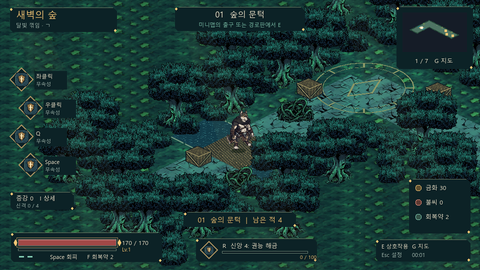
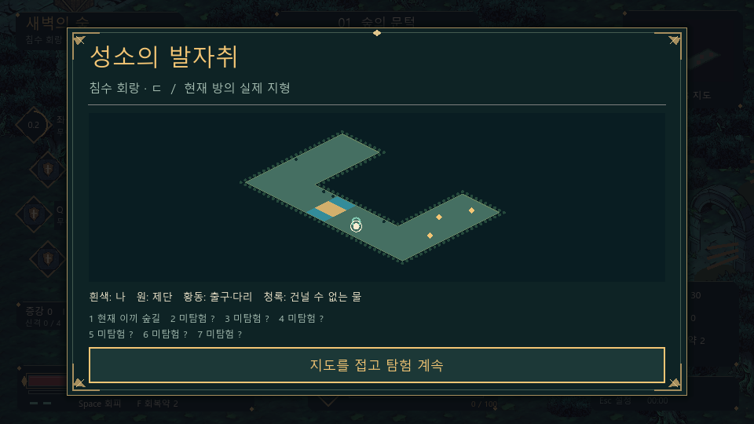

# 불씨의 성소 (Ember Sanctuary)

Godot 4.5.1 Windows x64용 쿼터뷰 액션 로그라이트 데모입니다.
첫 스테이지 **새벽의 숲**, 다섯 비직사각형 지형, 일곱 방과 수호자, 영구 강화가 포함됩니다.
Hades의 공간 표현과 타격 대비를 참고했습니다. 캐릭터·환경에는 사용자가 사용·편집·EXE/ZIP 재배포 권한을 확인하고 원본 활용을 승인한 두 이미지를 사용합니다. UI·몬스터·효과음은 자체 제작입니다.
배경 음악은 사용자가 제공하고 재배포를 허락한 Sunrise Over the Elder Grove입니다.

## 피드백 반영

- 바닥 자체를 **ㄱ자, ㄷ자, ㄹ자, 원환, 세 갈래 성역**으로 교체했습니다. 직사각형 방 안에 장애물을 세우는 방식이 아닙니다.
- 맵 외곽과 굽이 안쪽에 절벽 단면이나 검은 공백을 그리지 않습니다. 숲 바닥은 계속 이어지고, 덤불·바위 띠와 그 뒤의 수목 군락이 이동 경계를 표시합니다.
- 청록색 물길은 이동·회피·밀치기로 통과할 수 없습니다. 다리로만 건너며 적도 같은 지형과 경로를 사용합니다. 물 위로 화살은 날아가지만 울창한 숲 경계와 나무·석재 장애물은 투사체를 막습니다.
- 지형 셀 하나를 렌더링·충돌·내비게이션·적 생성·미니맵이 함께 사용합니다. 입구·제단·세 출구도 방마다 다른 위치에 놓입니다.
- 개 기사는 제공 이미지의 실제 그림을 배경에서 분리합니다. 얼굴·복장·비율을 새 도형으로 다시 그리는 방식이 아닙니다. 환경도 승인된 타일 예시에서 분리한 원본 재질·소품을 사용합니다.
- HUD를 왼쪽 공격별 증강 문양, 좌하단 체력·경험치·회피, 우측 자원, 하단 권능 게이지로 나눴습니다. 메뉴와 보상에는 금속 모서리 장식과 같은 청록색 석재 계열을 적용했습니다.
- 증강창을 즉시 활성화하지 않습니다. 세 선택지를 순서대로 드러내고, **등장 1초 이후 공격·선택 입력을 모두 놓은 상태로 0.25초**가 지나야 선택할 수 있습니다.
- 등장 전에 누른 마우스·숫자키·Enter·Space를 계속 누르고 있어도 획득되지 않습니다. 준비 안내 이후 새로 눌러야 합니다. 다시 보기·제단에서 다시 열기에도 보호가 적용됩니다.
- **좌클릭 약공격 / 우클릭 강공격 / Q 전투 스킬 / R 신앙 권능**을 분리했습니다.
- 약·강·스킬·회피마다 핵심 슬롯 하나가 있습니다. 예를 들어 불 약공격, 물 강공격, 바람 스킬을 동시에 사용할 수 있습니다.
- 부모 폴더의 enhancement.md를 기준으로 **일반 120종, 전설 10종, 쌍신 22종**으로 목록과 효과를 교체했습니다.
- 기존 단일 속성 고정, 공용 증강 12종, 능력 태그 2/3/4/6 시너지 및 6등급을 제거했습니다.
- 신앙, 권능, 휴면, 성장, 조건부 보상, 완성 보정, 시련 계약과 도감을 연결했습니다.





## 실행과 배포

- 개발 실행: `start_game.cmd`, 또는 `build\EmberSanctuary.exe`와 같은 폴더의 PCK.
- 배포용 단일 파일: `build\release\EmberSanctuary.exe`. 게임과 BGM이 포함됩니다.
- 배포 ZIP: `build\EmberSanctuary-Windows-x64.zip`.
- ZIP 구성: EXE, README.txt, GODOT_LICENSE.txt, GODOT_COPYRIGHT.txt.
- Windows 10/11 x64, OpenGL 3.3 호환 그래픽. Godot 설치는 필요 없습니다.
- 기본 1280×720, 최소 960×540. 키보드·마우스용이며 모바일·게임패드는 지원하지 않습니다.
- EXE는 코드 서명되지 않아 Windows SmartScreen 경고가 나타날 수 있습니다.

## 조작

| 행동 | 입력 |
|---|---|
| 화면 기준 이동 / 조준 | WASD·방향키 / 마우스 |
| 약공격 | 좌클릭 유지 / J |
| 강공격 | 우클릭 / K |
| 전투 스킬 | Q |
| 장착한 신앙 권능 | R |
| 회피 / 회복약 | Space / F |
| 상호작용 | E |
| 증강·권능 장착·도감·계약 | I |
| 지도 / 안내 | G / Tab |
| 일시정지·사운드 설정 | Esc |
| 조준 방식 / 화면 흔들림·섬광 / 음소거 | T / V / M |
| 증강 선택 | 새 클릭 또는 1·2·3 |
| 메뉴 조작 | Tab·Shift+Tab, Enter·Space, Esc |
| 사망·승리 후 재도전 | R |

약공격은 선딜 0.045초, 기본 간격 0.30초이며 3연격 마지막 타격은 1.6배입니다.
강공격은 선딜 0.30초, 기본 계수 2배, 재사용 0.85초의 방향성 베기입니다.
Q는 선딜 0.12초, 기본 계수 2.4배, 재사용 5.5초의 주변 공격입니다.
강공격과 Q 입력은 자동 약공격보다 우선하며, 짧은 선행 공격 중에는 0.2초 입력 버퍼를 사용합니다.
회피로 준비 중인 공격을 취소할 수 있습니다. 기본 회피는 2회 충전, 충전 1초입니다.
회피 중 약공격은 사거리 +22, 피해 +25%입니다.
기본 피격 무적은 0.75초이며 지속 피해에는 적용하지 않습니다.
일반 베기는 물길·숲 경계·장애물을 가로질러 적중하지 않습니다. Q의 주변 범위 효과는 지형 너머에도 닿습니다.

## 숲 지형과 아트

| 구조 | 이동과 공간 구성 |
|---|---|
| 달빛 꺾임 · ㄱ | 긴 세로 회랑을 올라 꺾이는 석재 길, 중간 다리 |
| 침수 회랑 · ㄷ | 가운데 수목 군락을 돌아가는 세 면의 회랑, 하단 물길 |
| 뿌리의 굽이 · ㄹ | 세 개의 가로 길을 번갈아 연결하는 굽이, 중앙 다리 |
| 잊힌 원환 | 가운데 울창한 숲을 둘러싼 두 방향 순환로, 동쪽 물길 |
| 세 갈래 성역 | 넓은 가로 성역과 남쪽 진입로, 중앙 다리 |

다섯 구조를 섞어서 모두 사용한 뒤 다시 섞습니다. 묶음 경계에서도 같은 구조가 연속으로 나오지 않습니다.
모서리는 낭떠러지가 아니라 자연물 군락의 경계입니다. 통로 바로 바깥의 모든 셀을 덤불·바위로 표시하고 그 뒤에는 나무를 배치합니다.
이 경계와 물가는 이동이 막힙니다. 회피를 길게 입력하거나 적에게 밀려도 건너뛰지 못하도록 이동을 짧게 나눠 검사합니다.
돌길은 바둑판 줄무늬가 아니라 각 방의 실제 진행 경로를 따라 이어집니다.
출구는 고정된 북·서·동 좌표가 아닙니다. 출구 위 안내의 **경로 선택 / 숲길 / 시련**을 보고 E로 이동하세요.
휴식·보물·상점·보스도 같은 다섯 구조를 사용합니다.

캐릭터·지면·주요 소품은 `assets/reference`와 `scripts/reference_art.gd`, 몬스터·수면·다리·속성 문양은 기존 `assets/sanctuary`와 `scripts/sanctuary_art.gd`를 사용합니다.
원본 분리 도구 `tools/prepare_reference_art.py`는 부모 폴더의 `tile_example.png`와 `knight_dog_character.png`를 읽습니다.
사용자는 두 이미지의 사용·편집·재배포 권한을 확인하고 게임 자산으로 활용하도록 승인했습니다. 이 승인은 다른 사람의 원본 단독 재배포 권한을 뜻하지 않습니다.
Python과 Pillow가 있는 개발 환경에서 `python .\tools\prepare_reference_art.py`로 분리 자산을 재생성합니다. 게임 실행에는 Python이나 부모 폴더의 원본이 필요하지 않습니다.
기존 보조 아틀라스는 `python .\tools\bake_sanctuary_art.py`로 재생성합니다.
캐릭터 원본은 정지 포즈 자료입니다. 네 방향 모두 각 원본 포즈를 분리했습니다. 네 번째 포즈의 검 끝에 겹친 표식 부분만 깨끗한 원본 검 픽셀로 복원했습니다(원본 좌표 기준 1,239픽셀). 얼굴·복장·털은 원본을 유지하지만 이 복원 부분까지 픽셀 단위로 완전히 동일한 것은 아닙니다.
걷기·공격은 같은 그림을 이동시키는 컷아웃 연출이며, 원본에 없던 손그림 관절별 애니메이션을 완성했다고 주장하지 않습니다.
몬스터 4종은 각각 4방향 × 8프레임(대기 1, 걷기 4, 공격 3)입니다. 정지한 몬스터는 걷기 프레임을 재생하지 않습니다.
모든 분리·가공은 로컬에서 수행하며 원본을 외부 이미지 서비스에 업로드하지 않습니다.
원본 타일 시트에서 잘린 나무 윗부분은 같은 시트의 잎 그림을 조합한 수관으로 이어 붙였으며, 수관·덤불은 세 변형을 사용해 평평한 절단면과 반복을 줄였습니다.
청록·이끼·먹색은 숲 유적의 깊이를, 황동은 UI 초점과 신격 선택을 구분합니다.
검은 털·크림색 주둥이·망토는 환경 속 플레이어 식별을 위한 실루엣입니다.
고밀도 원본을 축소 표시하고 화면 크기에 맞춰 그리므로 기존 16픽셀 스프라이트 확대 방식보다 계단이 작습니다.

## 신격과 슬롯

| 신격 | 속성 | 중심 효과 |
|---|---|---|
| 아르칸 | 무속성 | 치명타, 파열, 강공격 |
| 이그니스 | 불 | 화상, 소모 폭발, 화염 지대 |
| 니베아 | 얼음 | 냉기, 빙결, 파쇄 |
| 마레아 | 물 | 물결 표식, 밀치기, 벽 충돌 |
| 테라곤 | 땅 | 보호막, 균열, 반격 |
| 베르디아 | 풀 | 포자, 씨앗, 회복 |
| 아엘로 | 바람 | 회피, 이동, 집결 |
| 볼타르 | 번개 | 전하, 폭발, 연쇄 |
| 녹스 | 양자 | 공허 표식, 잔상, 지연 피해 |
| 오르디아 | 허수 | 질서 각인, 반복, 결계 |

각 신격의 01~04는 약·강·Q·회피 핵심, 05~12는 보조입니다.
같은 슬롯에 새 핵심을 고르면 기존 핵심은 제거됩니다. 레벨과 신앙도 함께 제거됩니다.
보조·전설·쌍신은 선행 조건을 잃으면 보유한 채 휴면하고, 조건을 복구하면 다시 활성화됩니다.
선택지에는 현재/성장 수치, 선행 조건, 신앙 변화, 제거할 핵심과 휴면될 증강이 표시됩니다.
야영지 및 I 화면의 **신격 도감**에서 전체 효과와 전설·쌍신 조건을 읽을 수 있습니다.
현재 플레이어의 고유 속성은 무속성입니다. 공격에 부여한 속성이 플레이어의 고유 속성을 바꾸지는 않습니다.

### 신앙과 권능

신앙은 현재 보유한 서로 다른 일반 증강 수입니다. 휴면 중인 일반 증강도 보유 수에 포함됩니다.
레벨, 전설·쌍신, 권능, 계약은 신앙 수를 늘리지 않습니다.

| 수집 | 자동 보상 |
|---|---|
| 1종 | 접촉 |
| 2종 | 해당 속성 피해 +10% |
| 4종 | 해당 신격 권능 해금 |
| 6종 | 해당 신격 신화 패시브 |

권능은 하나만 장착합니다. 첫 해금 권능은 자동 장착하고, 전투를 마친 방에서 I로 바꿀 수 있습니다.
조건을 잃으면 장착이 해제되지만 공통 게이지는 남습니다.
게이지는 최대 100, 전투 중 초당 2, 직접 적중으로 1씩 초당 최대 3까지 충전됩니다.
R로 100을 소비합니다. 지속·분신·반응·권능 피해와 피격은 적중 게이지를 만들지 않습니다.

### 등급과 성장

| 등급 | 일반 선택지 기본 가중치 | 성장 수치 배율 |
|---|---:|---:|
| 일반 | 65 | 1.00 |
| 희귀 | 25 | 1.20 |
| 영웅 | 10 | 1.45 |
| 전설 | 선행 조건에 따른 별도 후보 | 고정 |
| 쌍신 | 두 계열 조건에 따른 별도 후보 | 고정 |

65/25/10은 기획서에 확률이 지정되지 않아 정한 데모 기본값입니다.
계약 R08 완료 시 일반 등급 가중치는 45/35/20입니다.
등급마다 색뿐 아니라 문양, 등장 파편, 효과음이 다릅니다.
최대 레벨은 5, 성장 지정 수치는 `기본값 × 등급 배율 × (1 + 0.1 × (레벨 - 1))`입니다.
중첩 상한·추가 회피 수·타격 수·발동 간격·제어 시간·부활 수·방당 상한은 배율로 늘지 않습니다.
성장 가능한 보유 증강을 다시 선택하면 레벨이 1 증가하며 기존 등급을 유지합니다.
고정 기능만 있는 일반 증강과 전설·쌍신은 레벨업 후보가 아닙니다.
G12는 전투방 완료 시 성장 가능한 일반 증강 하나에 경험치 25를 줍니다. 100에 레벨이 1 오릅니다.

### 보상 풀과 완성 보정

- 일반 신격 풀은 런당 최대 4종을 등록하며, 핵심을 교체해도 등록 이력은 남습니다.
- 세 칸은 주력 슬롯·신격, 보조·조합, 신규 진입·범용 효과를 우선합니다.
- 선행 조건을 충족하지 못한 증강은 제시하지 않습니다.
- 신앙 3종에서 미보유 네 번째 일반 증강의 가중치를 높입니다.
- 같은 신격 보상 2회 동안 새로운 일반 증강을 얻지 못하면 다음 보상에 미보유 후보를 보장합니다.
- 조건을 충족한 전설은 해당 신격 세 번째 보상, 쌍신은 두 신격 합산 네 번째 보상에 후보를 보장합니다.
- 대기 중인 보장이 세 개를 넘으면 오래된 것부터 표시합니다.
- **후보 등장 보장이지 자동 획득은 아닙니다.** 다시 보기는 보장 카운터를 앞당기지 않습니다.

## 전투 효과와 원소 반응

P는 현재 공격력입니다. 파열·화상·냉기·물결·균열·포자·풍압·전하·공허·각인은 고유 속성과 별도로 관리합니다.
화상은 기본 5중첩, 포자는 5, 냉기는 6, 전하는 3, 각인은 4입니다.
화상은 중첩당 초당 P의 8%, 포자는 6%입니다. 재부여하면 전체 중첩의 지속시간을 갱신합니다.
씨앗은 기본 최대 3개, 2초 뒤 P의 50% 풀 범위 피해입니다. 상한 초과 시 가장 오래된 씨앗이 먼저 폭발합니다.
보호막은 최대 체력의 50%를 넘지 않습니다. 동일 보호막 갱신은 더 큰 양을 유지합니다.
보스는 밀치기·집결·빙결·속박에 면역이며, 모든 이동 감속을 합친 결과도 최대 20%입니다.
일반 적은 빙결·속박 종료 후 3초간 해당 제어에 면역입니다.
I12는 냉기 대상 회복 배율, Q10은 비보스 대상 사망 능력 차단 상태를 관리합니다.
현재 데모 몬스터에는 자체 회복·사망 발동 기술이 없으므로 두 효과의 가치는 후속 적 추가 시 드러납니다.

**약·강·Q의 본체 피해만 원소 반응과 일반 적중형 효과를 발생**시킵니다.
증강·지속·잔상·전이·쌍신·권능 피해는 다시 반응하거나 다른 적중형 증강을 호출하지 않습니다.
권능에 명시된 상태 부여, 전하 폭발에 명시된 연쇄 등은 해당 효과의 별도 경로로 처리합니다.
씨앗 재생성, 추가 잔상, 연쇄는 각각 생성 한계를 가지며 무한 재귀를 차단합니다.
이미 생성된 지연 피해와 장판은 생성 시 공격력·해당 속성 신앙 피해 배율을 유지합니다.

원소 반응은 공격 속성과 **대상의 고유 속성**으로 판정합니다.
일반 원소 7종은 융해·증발·용암·연소·과부하·빙결·동토·동해·초전도·진창·개화·감전·생장·모래폭풍·접지·활성·확산을 사용합니다.
무속성은 반응하지 않습니다. 양자·허수는 서로에게만 붕괴·역설을 발생시키며 일반 원소와는 반응하지 않습니다.
반응 규칙은 부모 폴더의 elements.md를 기준으로 합니다.

## 시련 계약

전투를 마친 방에서 **I > 시련 계약**으로 선택합니다.
동시에 최대 2개, 각각 다음 전투방 3개 완료 시 불이익이 해제되고 런 동안 보상이 유지됩니다.
같은 보상을 중복 획득할 수 없으며 신앙·신격 풀에 포함되지 않습니다.
10종은 공격속도, 강공격, 스킬 대기시간, 이동, 받는 피해, 회복, 재화, 최대 체력, 권능 충전, 추가 강화 적에 대응합니다.
C08 최대 체력 감소는 적용·해제 시 현재 체력 비율을 유지합니다.
R06은 늘어난 최대 체력만큼 회복하고, R10은 치명 피해 한 번만 막고 체력 30%로 생존시킵니다.
E12의 추가 금화는 방당 첫 강화 적 처치 시 8입니다. 경험치·금화 수량이 명시되지 않은 부분의 데모 설정입니다.

## 숲과 탐험

다섯 구조는 달빛 꺾임, 침수 회랑, 뿌리의 굽이, 잊힌 원환, 세 갈래 성역입니다.
한 주기 안에서 중복 없이 순환하며, 주기 경계에서도 같은 구조가 연속하지 않습니다.
장애물은 이동·투사체·적 경로 탐색·미니맵이 공유합니다.
출구의 숲길 표시는 일반, 시련 표시는 강화 전투이며 경로 선택 출구에서도 경로판을 열 수 있습니다.
네 번째 방은 휴식·보물·상인, 일곱 번째는 수호자입니다.
현재 7방은 유지했습니다. 기획서의 일반 증강 14~18개 수집 목표는 이후 다른 테마 스테이지가 이어지는 전체 런의 목표이며, 현재 숲 한 구간에서 보장하지 않습니다.
사망·귀환·정상 종료 시 모은 불씨를 정산합니다. 영구 강화 5단계는 단계마다 시작 체력 +12, 공격력 +2입니다.

## 사운드와 저장

게임 시작부터 제공된 MP3를 반복 재생합니다.
Esc의 사운드 설정에서 전체·BGM·효과음 음량, 음소거, 효과음 미리 듣기를 제공합니다.
설정과 불씨·영구 강화는 Godot 사용자 데이터 폴더에 저장합니다.
저장 실패·손상된 설정은 화면에 알리고 기존 파일을 보존합니다. 런 중 증강을 이어 하는 저장 기능은 없습니다.

## 구현과 검증

- `scripts/augments.gd`: 152종 데이터, 선행 조건, 성장, 신앙, 휴면, 선택지·보장.
- `scripts/deity_combat.gd`: 상태·직접 적중·증강 피해·권능·전설·쌍신·계약.
- `scripts/game.gd`: 세 공격 입력, 전투 연결, 보상 입력 보호·등장 연출, 도감·계약 UI.
- `scripts/elements.gd`: 고유 속성 기반 반응.
- `scripts/forest_maps.gd`: 공유 지형 셀, 다섯 외곽선, 물·다리, 입구·제단·출구.
- `scripts/sanctuary_art.gd`: PNG 아틀라스 렌더링과 방향·걷기·공격 프레임.
- `scripts/terrain_chart.gd`, `scripts/sanctuary_frame.gd`: 실제 지형 지도와 메뉴 프레임.
- `tests/catalog_test.gd`: 목록·조건·휴면·성장·풀·등급·보장 순수 규칙 검사.
- `tests/deity_test.gd`: 실제 공격·수치·권능·계약·반응 격리·보상 입력 회귀 검사.
- `tests/integration.gd`: 실제 뷰포트 입력, 메뉴, 쿼터뷰 조준, 일곱 방 전투.
- `tests/terrain_test.gd`: 연결성·안전 생성·다리·물가·자연물 경계의 표시/충돌 일치·50방 로테이션.

```powershell
.\runtime\Godot_v4.5.1-stable_win64.exe --headless --path . --script res://tests/catalog_test.gd
.\runtime\Godot_v4.5.1-stable_win64.exe --headless --path . -- --deity-test
.\runtime\Godot_v4.5.1-stable_win64.exe --headless --path . -- --ui-test
.\runtime\Godot_v4.5.1-stable_win64.exe --headless --path . -- --quarter-test
.\runtime\Godot_v4.5.1-stable_win64.exe --headless --path . -- --combat-test
.\runtime\Godot_v4.5.1-stable_win64.exe --headless --path . -- --terrain-test
```

`--self-test`와 `--overhaul-test`는 새 신격 회귀 검사로 연결됩니다.
소스 테스트는 에디터 실행으로 검사합니다. 릴리즈 EXE는 assert가 제거되므로 배포본 검사는 실행·리소스·UI 스모크용입니다.
밸런스, 152종 전체 조합의 장시간 플레이, 후속 스테이지의 수집 곡선은 별도 플레이테스트가 필요합니다.

### UI 설계와 확인 기준

- Design Read: 숲 유적을 탐험하는 PC 액션 게임, 청록색 석재·먹색 망토·황동 각인의 언어. ENERGY 3 / RHYTHM 2 / MOTION 3.
- 청록색 숲 유적·밝은 양피지 글자·황동 강조로 전투와 메뉴가 같은 세계에 속하게 했습니다.
- 왼쪽 문양은 약·강·Q·회피에 실제 장착한 속성을 보여 줍니다. 재사용 시간은 숫자와 원형 진행으로 함께 표시합니다.
- 체력은 좌하단, 자원은 우측, 권능은 하단에 분리하여 화면 중심의 적과 공격 예고를 가리지 않게 했습니다.
- 모서리 각인과 이중 프레임은 숲의 유적·금속 장비 모티프입니다. 메뉴 그림자는 전투 공간과 대화상자의 깊이 구분에만 사용합니다.
- 세 칸은 한 번의 보상에서 세 후보를 비교하기 위한 구조이며, 긴 효과는 칸 내부 스크롤로 읽습니다.
- 순차 공개와 입력 잠금은 공격을 이어 누르는 동작과 보상 결정을 분리하기 위한 연출입니다.
- 등급 문양·텍스트·음정을 함께 사용해 색만으로 등급을 구별하지 않게 했습니다.
- 기본 시스템 글꼴은 한글 가독성, 여백과 짧은 버튼은 960×540 비교 화면을 위한 선택입니다.
- ENERGY 3 / RHYTHM 2 / MOTION 3. V로 섬광·흔들림을 끄더라도 입력 보호 시간은 유지됩니다.
- 배포 전 보상·증강·설정·야영지의 최소 해상도, 키보드 초점, 선택·다시 보기·닫기, 콘솔 오류를 확인합니다.

### 이번 빌드 검증 결과

| 검사 | 결과 | 근거 |
|---|---|---|
| 목록·선행·휴면·성장·풀·보장 | PASS | 순수 규칙 5,057개 검사, 실패 0 |
| 전투 효과 | PASS | 세 공격 독립 속성, 전설 10종, 쌍신 D01~D22의 피해·상태·보호막·회복·횟수 검사 |
| 권능·계약 | PASS | 권능 10개 장착 버튼 실제 클릭과 피해 수치, 계약 10개 실제 클릭·불이익·3방 완수·보상 검사 |
| 보상 입력 보호 | PASS | 좌클릭·약공격 유지, 숫자·Enter·Space·J·K·Q·R 유지, 해제 후 재입력, 다시 보기·다시 열기 검사 |
| 메뉴 입력 | PASS | 세 선택지 획득, 재추첨, 미루기·재개, 도감·계약·지도·설정·상점·휴식·재도전·귀환 검사 |
| 사운드 설정 | PASS | Esc 설정, 키보드 음량 슬라이더, 효과음 미리 듣기, 음소거, 닫기 실제 입력 |
| 쿼터뷰 | PASS | 8방향 조준·실제 피해, WASD 입력, 8방향 회피 |
| 지형 | PASS | 5종 숲 공터, 안전 생성 지점 1,423개, 제단·세 출구 경로, 물가 71곳·자연물 경계 666곳 회피 차단, 모든 접경 셀 표시·충돌 일치, 다리 통과, 출구 간격·경로판, 50방 순환 |
| 일곱 방 | PASS | 실제 전투로 보스 포함 32처치, 최종 체력 81.5, 강제 적 사망·강제 회복 없음 |
| 배포 EXE | PASS | 외부 작업 폴더에서 UI·일곱 방 스모크, 그래픽 지도 캡처, 실제 종료 버튼 입력·정상 종료 |
| 배포 BGM | PASS | 실제 재생 상태 true, 재생 위치 양수, 길이 약 178.86초, 종료 버튼 정상 |

### UI Delivery Gate

| 구분 | 확인 항목 | 결과와 근거 |
|---|---|---|
| Hard | R-02 문장 부호 | PASS: 새 문구에 금지된 긴 대시 없음 |
| Hard | R-03 화면 대응 | PASS: 지원 최소 960×540 보상·지도, 1600×900 전투·숲·메뉴 캡처. 긴 설명 내부 스크롤, 모바일 미지원 명시 |
| Hard | R-17 숫자 | PASS: 게임 데이터·위 테스트 실측만 사용 |
| Hard | R-18 후기 | PASS: 후기·가공 인물 없음 |
| Hard | R-23 자산 | PASS: 두 원본의 사용·편집·재배포 권한과 원본 활용을 사용자에게 확인, 임의 로고·인물 없음 |
| Hard | R-24 탐색 | PASS: 도감·계약·설정·지도 버튼의 실제 목적지 확인 |
| Hard | R-25 대비 | PASS: 밝은 글자·보조 글자·등급색·상태색과 메뉴 배경 126조합 검사, 최소 4.59:1 |
| Hard | R-26 동작 | PASS: 세 선택·다시 보기·닫기·권능 10개·계약 10개·설정 실제 입력 |
| Hard | R-27 상태 | PASS: 미보유 안내, 등장 중 잠금 안내, 잘못된 보상/증강·저장 오류 안내 경로 존재 |
| Hard | R-28 FAQ | PASS: 관계없는 FAQ 없음 |
| Hard | R-32 키보드 | PASS: Tab 초점 테두리, Enter·Space, 숫자키·Esc 입력 검사, 스크롤 내 초점 추적 |
| Hard | R-33 소스 편집 | PASS: 직접 패치, 소스 재작성용 외부 스크립트 없음 |
| Hard | R-34 테마 | PASS: 숲 배경 위 고정 게임 메뉴, 테마 토글 없음 |
| Hard | R-35 실행 | PASS: 소스 테스트·실제 입력·OpenGL 캡처·배포 EXE 실행 완료 |
| Hard | R-36 주장 | PASS: 인증·성능·후기 등 확인되지 않은 주장 없음 |
| Hard | R-37 방향 | PASS: 사용자 지정 UI 사진·숲 유적·개 기사 방향, 다이얼과 Design Read를 위에 기록 |
| Hard | R-38 내용 | PASS: 제공된 신격 기획 데이터와 실제 구현만 표시, 미정 수량은 데모 기본값 명시 |
| Purpose | R-01 색·R-04 문양 | PASS: 숲/양피지 위계와 등급 식별 목적, 문양은 실제 등급에 대응 |
| Purpose | R-06 글꼴·R-07 배경 | PASS: 한글 시스템 글꼴, 실제 숲 게임 화면. 장식용 격자 없음 |
| Purpose | R-08 화살표·R-09 배지 | PASS: 수치 변화에만 화살표 사용, 등급은 실제 상태 텍스트 |
| Purpose | R-10 유리·R-12 그림자·R-13 광원 | PASS: 블러·유리 효과 없음. 대화상자 분리용 그림자와 세계 그림자, 피격/등급 강조만 사용 |
| Purpose | R-14 세 칸·R-19 연출 | PASS: 동시 3후보 비교, 순차 공개와 입력 장벽으로 오선택 방지 |
| Purpose | R-22 그림 | PASS: 요청된 숲 유적·검은 망토의 개 기사·몬스터 PNG, 범용 홍보 일러스트 없음 |
| Liveliness | 다이얼 | PASS: ENERGY 3 / RHYTHM 2 / MOTION 3, 전투·보상 전환·설정 정지 상태로 확인 |
| Liveliness | 초점·여백 | PASS: 보상 세 후보, 설정 슬라이더, 도감 본문을 각 화면 중심으로 구성 |
| Liveliness | 강조·모티프·방향 | PASS: 금빛 초점, 숲/양피지 언어를 유지. 방향은 본 문서의 UI 설계 항목에 기록 |
| Craft | C-1 의도·C-3 내용 | PASS: 슬롯·비교·전설 조건·잠금 안내에 필요한 요소만 추가 |
| Craft | C-2 완결·C-4 회복력 | PASS: 실제 입력 및 비어 있음·잠금·오류·긴 설명·키보드 경로 확인 |
| Craft | C-5 근거 | PASS: 테스트 결과와 미구현 후속 스테이지 범위를 구분 |
| Quality | R-05 구조·R-11 형태·R-15 버튼·R-16 문구 | PASS: 게임 보상·도감·계약 구조, 기존 각진 형태, 구체적인 행동 문구 |
| Quality | R-20 정체성·R-21 테마·R-29 팔레트 | PASS: 숲·불씨·양피지 위계 유지, 등급색은 상태 식별에만 사용 |
| Quality | R-30 참고·R-31 이유 | PASS: 사용자 승인 원본으로 요청된 캐릭터·환경 표현, 그 외 게임 파일 추출 없음. 주요 시각 결정의 이유를 위에 기록 |
